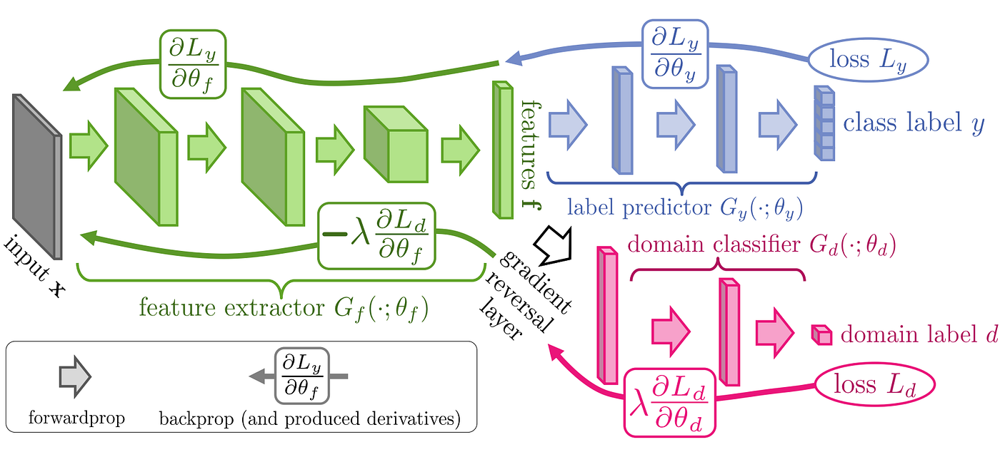
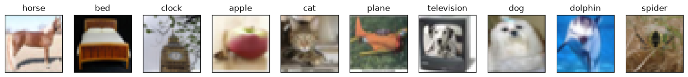
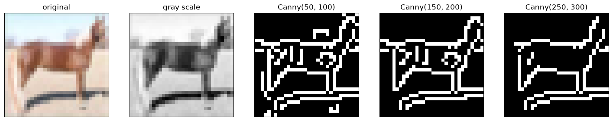
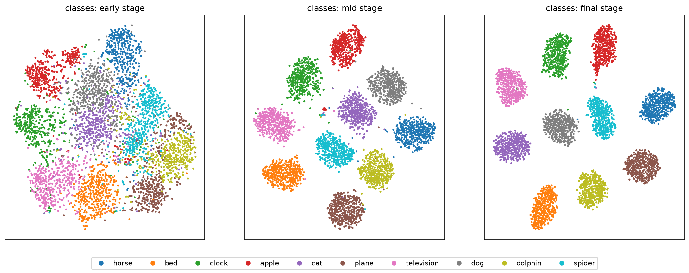
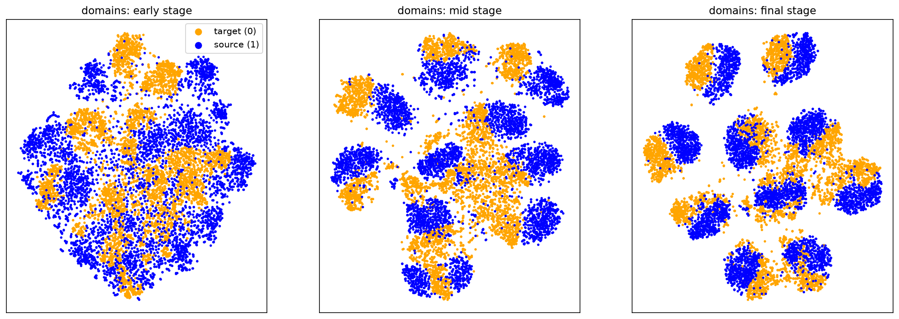

# Domain Adaptation
Input -> Feature extractor -> Features -> Domain classifier / Label predictor

- Feature extractor: 特徵擷取
    - train dataset
- Domain Classifier: 區分資料來源 (Test/Train)
    - train dataset + test dataset
- Label predictor: 區分圖片分類 (class)

## Task
- 用 Train dataset 來訓練同樣能辨識 Test dataset 的模型
- Q: 特徵分佈不同
- A: 使特徵分佈盡可能相似

## Dataset
- 10 Class (0 - 9)
- Train (source): 5000
    - with label
    - 32 * 32 * 3

- Test (target): 100000 
    - without label
    - 28 * 28 * 1
    - class 數量相同


## Process

- Train dataset
1. 從 RGB 轉為黑白
2. 用 Edge detection 來找出 Train dataset 的邊緣 (模擬 Test dataset)
```python
Canny(low_threshold=170, high_threshold=300)
```
3. Data Augmentation
- Test dataset
1. Resize
2. Data Augmentation

## Model
### Feature Extractor
- kernel=3, stride=1, padding=1
- Input: 32 * 32 * 1 dim
- Output: 512 dim
- Architecture:
    - ((Conv2d + BatchNorm2d + ReLU) * 2 + MaxPool2d) * 2
    - (Conv2d + BatchNorm2d + ReLU) * 1 + MaxPool2d
    - AdaptiveAvgPool2d + Flatten

### Label Predictor
- Input: 512 dim
- Output: 10 dim
- Architecture:
    - (Linear + ReLU + Dropout(0.5)) * 2
    - Linear * 1

### Domain Classifier
- Input: 512 dim
- Output: 1 dim (source = 1, target = 0)
- Architecture:
    - (Linear + BatchNorm1d + ReLU + Dropout(0.5)) * 4
    - Linear * 1


|  | Feature Extractor | Label Predictor | Domain Classifier |
| -------- | -------- | -------- | -------- |
| Input     | Source + Target     | Source feature     | Source feature + Target feature     |
| Output     | 512 dim     | 10 class     | 1 domain (0/1)     |
| Loss     | $\mathcal{L}_{class} - \lambda \mathcal{L}_{domain}$     | $\mathcal{L}_{class}$     | $\mathcal{L}_{domain}$     |

## Training
- loss = cross-entropy
- train domain classifier
    - feature extractor (detach)
    - $\mathcal{L}_{domain}$
- train feature extractor and label predictor
    - feature extractor (undetach)
    - $\mathcal{L}_{class} - \lambda \mathcal{L}_{domain}$
- $\lambda$
    - 先學 label ，再學 domain (前面的 feature 沒意義)
    - $p = \frac{\text{epoch}}{\text{EPOCHS}}$
    - $\lambda = \lambda_{max} \cdot \left(\frac{2}{1 + e^{-10p}} - 1\right), \lambda_{max}=0.5$ (=1 反向猜錯)

```python
p = epoch / EPOCHS
lamb = LAMB_MAX * (2. / (1. + np.exp(-10 * p)) - 1)
```
## Label Balance
- 預測 test dataset 的時候，class 數量不同
- 已知 test dataset 的各個 class 數量相同
- Balance:
    - 計算個別 class 的平均
    - 同一類別除以此平均 (正規化)
    - argmax 找新的代表 class
```python
def balance_predict(probs):
    return (probs / probs.mean(0, keepdims=True)).argmax(1)
```

## Result
- Class t-sne

- Domain t-sne

- Private Score = 0.76492
- Public Score = 0.76270
