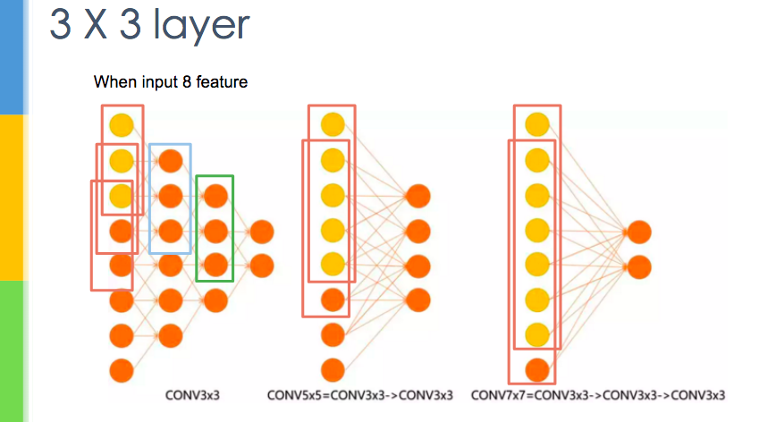
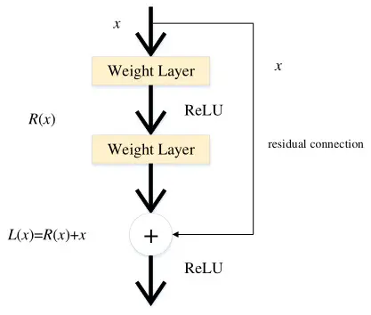
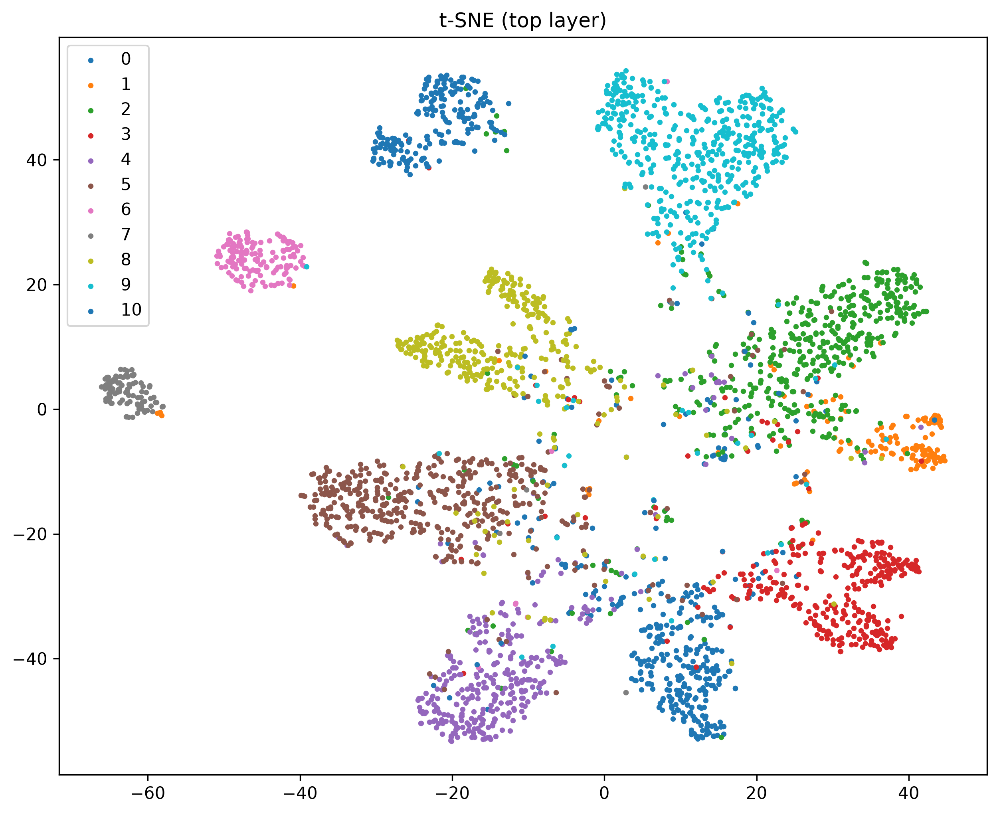

# CNN
Image -> Convolution + Activation Function -> Pooling -> Flatten -> FCN -> Category

## Dataset
- food-11: 11 種食物類型
- Train: 9866
- Vaild: 3430
- test: 3347

## Data Augmentation
```python
train_tfm = transforms.Compose([
    transforms.RandomResizedCrop(128, scale=(0.4, 1.0)), 
    transforms.RandomHorizontalFlip(),
    transforms.TrivialAugmentWide(),
    transforms.ToTensor(),
    transforms.Normalize([0.5, 0.5, 0.5], [0.5, 0.5, 0.5]),
    transforms.RandomErasing(p=0.25),
])
```
- RandomResizedCrop: 隨機裁切部分區域並還原成特定大小
- RandomHorizontalFlip: 水平翻轉
- TrivialAugmentWide: 從各種操作中挑一種，隨機強度 [Ref.](https://pytorch.com.tw/vision/0.22/generated/torchvision.transforms.v2.TrivialAugmentWide.html)
- Normalize: pixel [-1, 1]
- RandomErasing: 隨機隱藏部分區域

## Model (VGG)
### Block:
- Conv => BN => ReLU => Conv => BN => ReLU => Max Pooling (*5)
- AlexNet:
    - Kernel: (3\*3), (5\*5) ... 
    - different kernel
- VGG: 
    - kernel: all (3*3)
    - 2 layer (3*3) => (5\*5)

```python
nn.Conv2d(3, 64, 3, 1, 1),
nn.BatchNorm2d(64),
nn.ReLU(),
nn.Conv2d(64, 64, 3, 1, 1),
nn.BatchNorm2d(64),
nn.ReLU(),
nn.MaxPool2d(2, 2, 0),
```
### FCN
```python
self.fc = nn.Sequential(
    nn.Dropout(0.5),
    nn.Linear(512*4*4, 1024),
    nn.ReLU(),
    nn.Dropout(0.5),
    nn.Linear(1024, 512),
    nn.ReLU(),
    nn.Linear(512, 11)
)

def forward(self, x):
    out = self.cnn(x)
    out = out.view(out.size()[0], -1) # flatten
    return self.fc(out)
```
### Residual Connection
- ResNet
    - 把輸入 x 直接加到輸出上
    - 模型只需要學輸入和輸出的差別


## Test Time Augmentation (TTA)
- 測試時也做資料增強，把預測結果 softmax 平均


## Training
| | Sample Code | Final |
|---|---|---|
| Optimizer | Adam | AdamW |
| Learning Rate | 3e-4 | 1e-3 |
| Weight Decay | 1e-5 | 5e-2 |
| LR Scheduler | - | Cosine |
| Batch Size | 64 | 128 |
| Epochs | 8 | 300 |
| Patience | 5 | 40 |

## t-SNE
- 降維 (512 -> 2)
- FCN last layer

Private Score = 0.89671 (Boss)
Public Score = 0.89940 (Boss)