# Diffusion Model

## DDPM
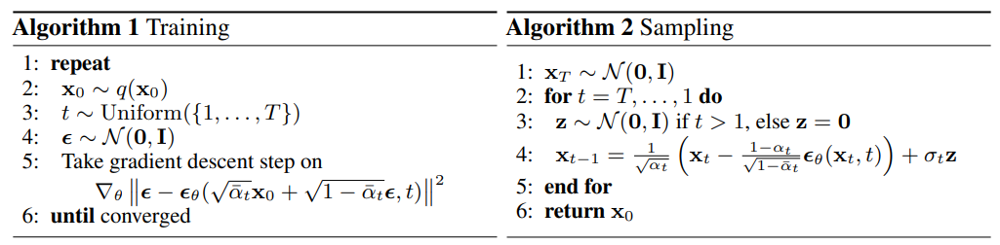
- 
## DDIM
- 非馬可夫鏈結構
- reverse process 不額外加入新的 noise
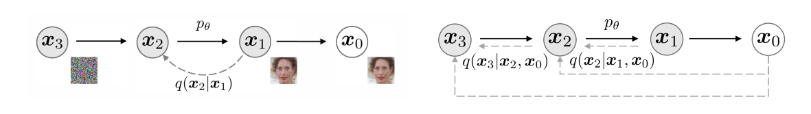
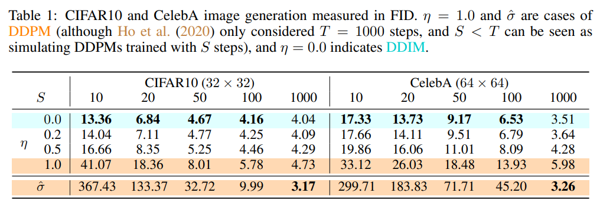
## GAN
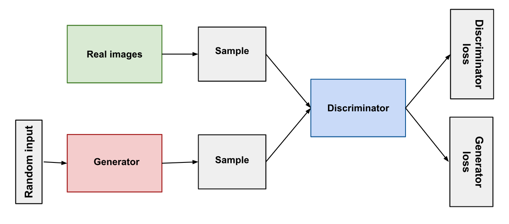
- Generator: generate images
    - 判斷正確，Discriminator 被罰
- Discriminator: judge images
    - 判斷正確，Generator 被罰
## Image Generation Model
|  | Diffusion Model | GAN |
| -------- | -------- | -------- |
| 訓練速度    | 慢     |   快   |
| 訓練穩定度    | 好     |   差   |
| 多樣性    | 好     |   差   |

## Dataset
[Dataset](https://www.kaggle.com/datasets/b07202024/diffusion)

- Theme: Anime Girl Face
- Quantity: 71.3k
- Size: 96 * 96 
## Evaluation
### FID
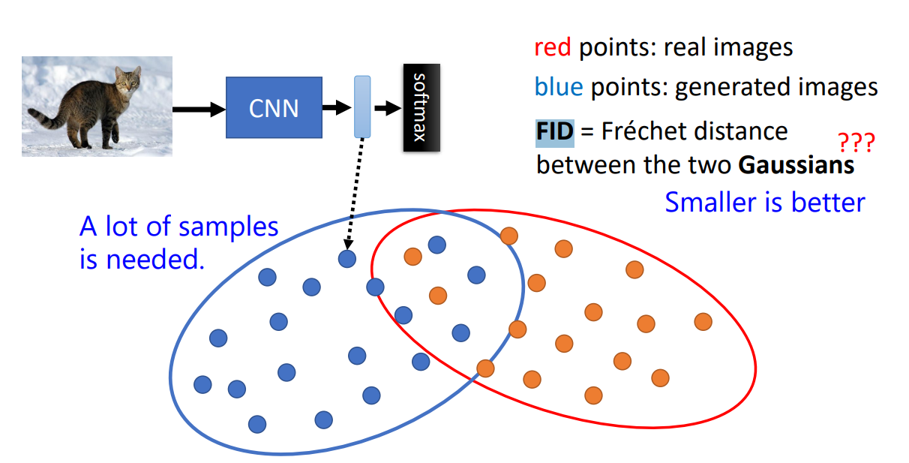
- Input: Generated Image and Real Image
- Pre-trained CNN output Latent
- Assume we regard latent as a Gaussian Distribution
- Compute Distance between two Gaussian Distribution
### AFD
[AFD Repo](https://github.com/hysts/anime-face-detector)
- 用 Anime Girl Face Detector 來判斷哪幾張圖是目標圖片
## Result
### Sample Code
| Sample Code |  |
| -------- | -------- |
| model    | DDIM     |
| batch_size    | 32     |
| train_num_steps    | 10000     |
| lr    | 1e-3     |
| channels    | 16     |
| dim_mults    | (1, 2, 4)     |
| timesteps    | 100     |
| sampling_timesteps    |  25    |
| beta_schedule     | linear     |
| Optimizer     | cosine     |
| pred     | pred_v     |
| other     | None     |

> [!Info] Sample Code
> FID score: 134.93
> AFD rate:  71.50%
> 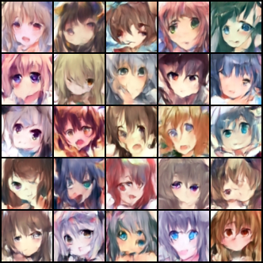

### train_num_steps
- train_num_steps = 30000
- 訓練總共要更新幾次參數

> [!Info] train_num_steps
> FID score: 131.71 (134.93)
> AFD rate:  74.30% (71.50%)
> 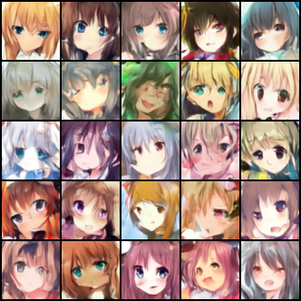

### timesteps
- timesteps = 1000
- Add Noise 次數

> [!Info] timesteps
> FID score: 134.94 (134.93)
> AFD rate:  71.20% (71.50%)
> 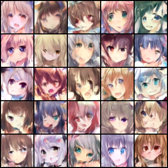

### sampling_timesteps
- sampling_timesteps = 99 (99, 97, 96...)
- Denoise 次數
( If sampling_timesteps = 100, then DDPM )

> [!Info] sampling_timesteps
> FID score: 139.77 (134.93)
> AFD rate:  69.30% (71.50%)
> 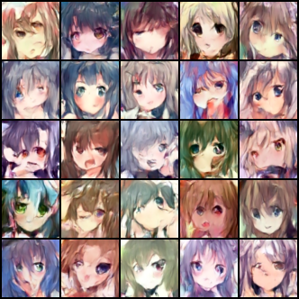

### beta_schedule
- beta_schedule = 'cosine'
- 每次 steps 加入 noise 的數量
    - Cosine: 緩慢
    - Linear: 快速
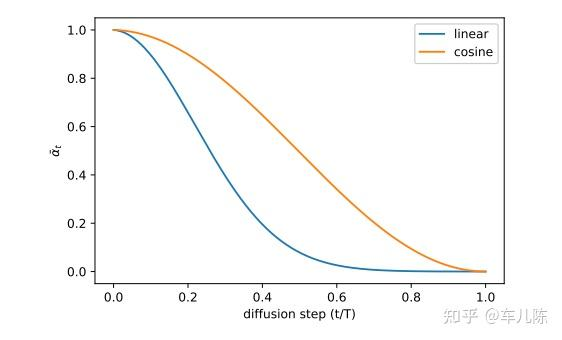
> [!Info] beta_schedule
> FID score: 132.07 (134.93)
> AFD rate:  71.40% (71.50%)
> 

### channels
- channels = 32
- 一層卷積有幾個 feature map
> [!Info] channels
> FID score: 118.90 (134.93)
> AFD rate:  65.50% (71.50%)
> 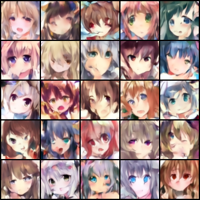

### dim_mults
- dim_mults = (1, 2, 4, 8)
- UNet 每一層 channel 數的倍率

| level | mults | resolution | channel |
| -------- | -------- | -------- | -------- |
|  1   |  1    |  64 * 64    |  32    |
|  2   |  2    |  32 * 32    |  64    |
|  3   |  4    |  16 * 16    |  128    |
|  4   |  8    |  8 * 8    |   256    |

> [!Info] dim_mults
> FID score: 150.44 (134.93)
> AFD rate:  73.70% (71.50%)
> 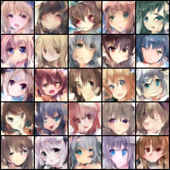

### Data Augmentation
- 水平翻轉
    - T.RandomHorizontalFlip(p=0.5)
- 顏色
    - T.ColorJitter(brightness=0.2, contrast=0.2, saturation=0.2, hue=0.2)
> [!Info] Data Augmentation
> FID score: 151.61 (134.93)
> AFD rate:  46.40% (71.50%)
> 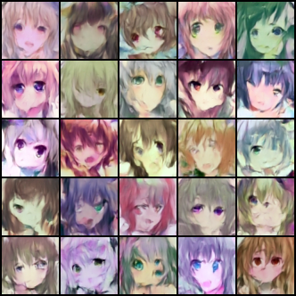

### batch_size
- batch_size = 64
- 一次訓練看多少張圖片
> [!Info] batch_size
> FID score: 131.61 (134.93)
> AFD rate:  73.50% (71.50%)
> 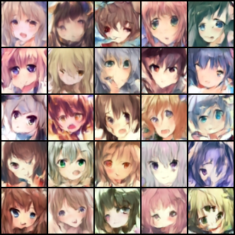

### AdamW
- 加快收斂
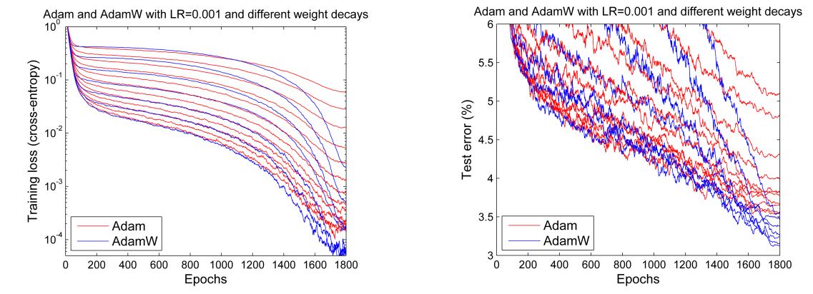
> [!Info] AdamW
> FID score: 140.48 (134.93)
> AFD rate:  67.70% (71.50%)
> 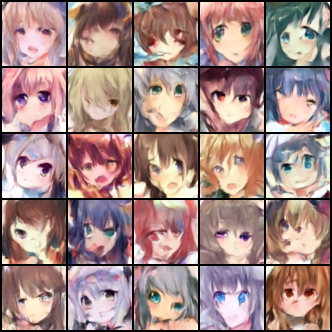

### objective
- objective = 'pred_noise'
    - pred_noise: $\epsilon$
        - 預測噪音
    - pred_x0: $x_{0}$
        - 直接預測原圖
    - pred_v: $v=\alpha_t\epsilon-\sigma_t x_0$
        - 比例混合

> [!Info] objective
> FID score: 161.27 (134.93)
> AFD rate:  13.12% (71.50%)
> 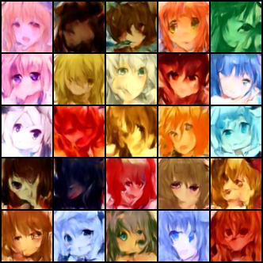

### Final
| Final Version |  |
| -------- | -------- |
| model    | DDIM     |
| batch_size    | 128    |
| train_num_steps    | 60000     |
| lr    | 2e-4     |
| channels    | 128     |
| dim_mults    | (1, 2, 4, 8)     |
| timesteps    | 2000     |
| sampling_timesteps    |  200    |
| beta_schedule     | cosine     |
| Optimizer     | AdamW     |
| pred     | pred_v     |
| other     |  Data Augmentation    |

> [!Info] Final
> FID score: 78.31 (134.93)
> AFD rate:  91.90% (71.50%)
> 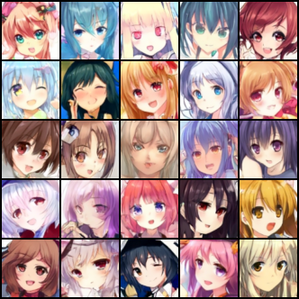

### StyleGAN
> [!Info] StyleGAN
> FID score: 60.38 (134.93)
> AFD rate:  94.70% (71.50%)
> 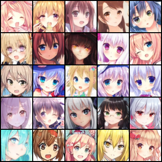

