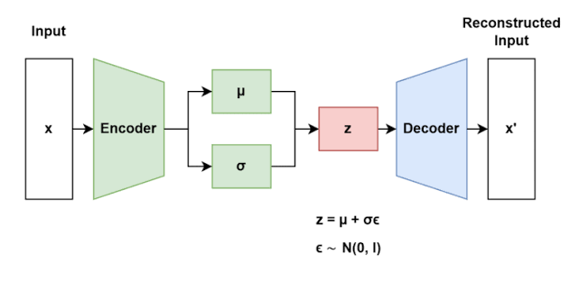
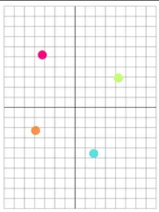
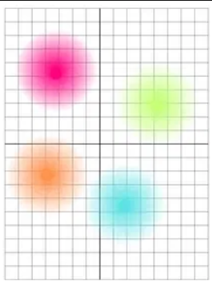
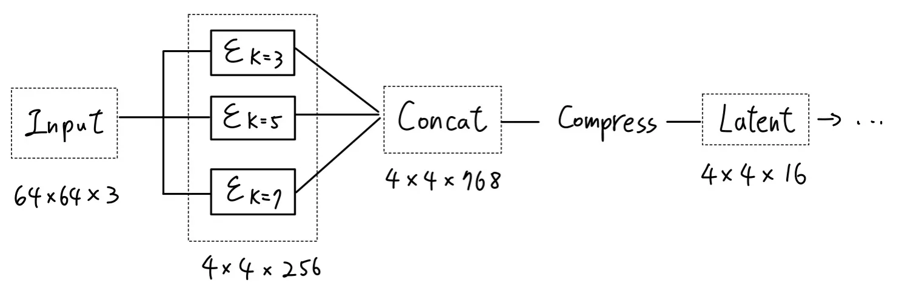
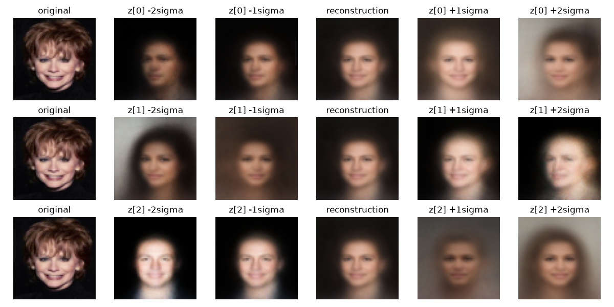

# Autoencoder
Input -> Encoder -> Latent Space -> Decoder -> Output

## Anomaly Detection
- 正常資料數量 >>> 異常資料數量
- 難以窮舉
- Unsupervised Learning
- Train Autoencoder -> Anomaly Score -> Indify 0/1
## Dataset
- Human faces: 64 * 64 * 3
- Train: 100000 (正常)
- Test: 19636 (異常 + 正常)


## Model

### FCN Autoencoder
- latent = 3
- Encoder
    - Input: 64 * 64 * 3 dim
    - Output: 3 dim
    - Architecture:
        - (Linear + ReLU) * 3
        - Linear * 1
- Decoder
    - Input: 3 dim
    - Output: 64 * 64 * 3 dim
    - Architecture:
        - (Linear + ReLU) * 3
        - (Linear + Tanh) * 1
        
### Conv Autoencoder
- kernel=4, stride=2, padding=1
- latent = 8 * 8 * 48
- Encoder
    - Input: 64 * 64 * 3 dim
    - Output: 8 * 8 * 48 dim
    - Architecture:
        - (Conv2d + ReLU) * 3
- Decoder
    - Input: 8 * 8 * 48 dim
    - Output: 64 * 64 * 3 dim
    - Architecture:
        - (ConvTranspose2d + ReLU) * 2
        - (ConvTranspose2d + Tanh) * 1

### VAE


|  | AE | VAE |
| -------- | -------- | -------- |
| Input     | Vector     |  $\mu$、$\sigma$    |
| Latent     | 點     |  分佈    |
| Latent Space     |      |      |
| Loss     |   $\mathcal{L} = \text{MSE}(\hat{x}, x)$   |  $\mathcal{L} = \text{MSE}(\hat{x}, x) + \text{KLD}$    |
| Quality     |   Better   |  Worse    |
| Task     |   Reconstruction   |  Generation    |


- kernel=4, stride=2, padding=1
- latent = 4 * 4 * 256
- Encoder
    - Input: 64 * 64 * 3 dim
    - Output: $\mu$, $\log\sigma^2$ 各 4 * 4 * 256 dim
    - Architecture:
        - (Conv2d + BatchNorm2d + ReLU) * 3
        - Conv2d * 1 ($\mu$)、Conv2d * 1 ($\log\sigma^2$) 兩個分支
- Reparameterization (for Backpropagation)
    - $z = \mu + \sigma \odot \epsilon$
    - $\mu$, $\sigma$ 建立關聯性 $z$
- Decoder
    - Input: 4 * 4 * 256 dim
    - Output: 64 * 64 * 3 dim
    - Architecture:
        - (ConvTranspose2d + ReLU) * 2
        - (ConvTranspose2d + Tanh) * 1
- Loss
    - $\mathcal{L} = \text{MSE}(\hat{x}, x) + 10^{-3} \cdot \text{KLD}$
    - $\text{KLD} = -\frac{1}{2} \cdot \text{mean}\left(1 + \log\sigma^2 - \mu^2 - \sigma^2\right)$

### Multi-Encoder Autoencoder


- kernel=3 / 5 / 7, stride=2, padding=1 / 2 / 3 (padding = k // 2)
- latent = 4 * 4 * 16
- Encoder (每個 encoder 用不同 kernel size)(* 3)
    - Input: 64 * 64 * 3 dim
    - Output: 4 * 4 * 256 dim
    - Architecture:
        - (Conv2d + BatchNorm2d + ReLU) * 4
        - channels: 3 => 32 => 64 => 128 => 256
- Compress (把三條 encoder 的輸出合成，並壓縮成 latent)
    - Input: 4 * 4 * 768 dim
    - Output: 4 * 4 * 16 dim
    - Architecture:
        - (Conv2d + BatchNorm2d + ReLU) * 1
        - Conv2d * 1
        - channels: 768 => 256 => 16
- Decoder
    - kernel=4, stride=2, padding=1
    - Input: 4 * 4 * 16 dim
    - Output: 64 * 64 * 3 dim
    - Architecture:
        - (ConvTranspose2d + BatchNorm2d + ReLU) * 3
        - (ConvTranspose2d + Tanh) * 1
        - channels: 16 => 128 => 64 => 32 => 3

## Anomaly Score
- 計算重建圖和原圖之間的誤差
$$\text{score}(x) = \sqrt{\frac{1}{3 \cdot 64 \cdot 64} \sum_{i} (\hat{x}_i - x_i)^2}$$

```python
loss = eval_loss(output, img).reshape(img.shape[0], -1).mean(-1)
anomality = torch.sqrt(torch.cat(anomality)).cpu().numpy()
```
## Reshape
- 正中央 32 * 32 的圖片
- 把誤差圖外圍刪除
- 整體誤差平均
```python
err = eval_loss(output, img).reshape(img.shape[0], 3, 64, 64)
loss = err[:, :, 16:48, 16:48].reshape(img.shape[0], -1).mean(-1)
```

## Result
- 測試 FCN Autoencoder 的 3 dim latent
- 調整 $\sigma$ 給 decoder 重建
- 觀察 latent 所學到的東西

- Private Score = 0.80256
- Public Score = 0.79708